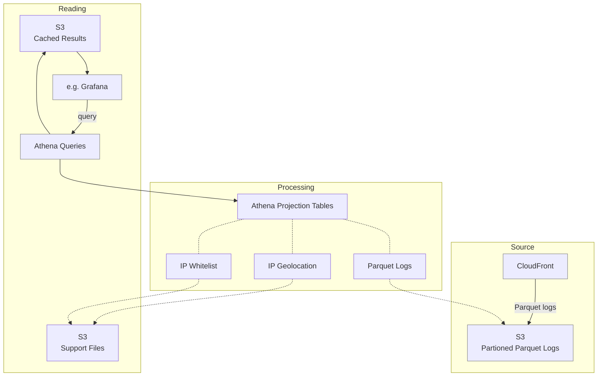
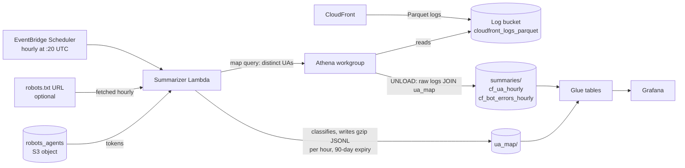

# CloudFront Logs Analyzer - Terraform Module

This module provides a AWS resources and helper scripts to analyze CloudFront Parquet logs using AWS Glue and Athena.

## Basic Usage

Replace `x.y.z` with the release that includes the inputs used (`summaries`, `athena_workgroup`, `results_expiration_days` need the next release after 0.3.1).
Minimal
```
module "global_logs_analyzer" {
  source  = "tx-pts-dai/cloudfront-logs-analyzer/aws"
  version = "x.y.z"

  cloudfront_distribution = {
    ids = ["{distribution-id}"]
  }

  s3_parquet_bucket = {
    name = "my-logs-abc"
    logs_prefix = "AWSLogs/{account_id}/Cloudfront/"
  }
  s3_results_bucket = {
    create = true
  }
}
```

Global
```
module "global_logs_analyzer" {
  source  = "tx-pts-dai/cloudfront-logs-analyzer/aws"
  version = "x.y.z"

  cloudfront_distribution = {
    ids = ["{distribution-id}"]
  }

  s3_parquet_bucket = {
    name = "my-logs-abc"
    logs_prefix = "AWSLogs/{account_id}/Cloudfront/"
  }

  s3_results_bucket = {
    create = true
  }

  # Do not place both files in the same folder
  # Athena would mix them up due to common column names
  s3_supporters_files = {
    ip_whitelist_fullpath   = "s3://arn/full/path/to/folder"
    ip_geolocation_fullpath = "s3://arn/full/path/to/folder2"
  }
 
  grafana_access = {
    create = true
  }
}
```

Per Distribution
```
module "per_distrologs_analyzer" {
  source  = "tx-pts-dai/cloudfront-logs-analyzer/aws"
  version = "x.y.z"

  cloudfront_distribution = {
    ids  = ["{distribution-id-to-analyze}"]
    name = "DistroName"
  }

  s3_parquet_bucket = {
    name = "my-logs-abc"
    logs_prefix = "AWSLogs/{account_id}/Cloudfront/{distro_id}/"
  }

  s3_results_bucket = {
    create = true
  }

  # Do not place both files in the same folder
  # Athena would mix them up due to common column names
  s3_supporters_files = {
    ip_whitelist_fullpath   = "s3://arn/full/path/to/folder"
    ip_geolocation_fullpath = "s3://arn/full/path/to/folder2"
  }

  grafana_access = {
    create = true
  }
}
```

With UA summaries and workgroup guardrails (all optional)
```
module "global_logs_analyzer" {
  source  = "tx-pts-dai/cloudfront-logs-analyzer/aws"
  version = "x.y.z"

  cloudfront_distribution = {
    ids = ["{distribution-id}"]
  }

  s3_parquet_bucket = {
    name = "my-logs-abc"
    logs_prefix = "AWSLogs/{account_id}/Cloudfront/"
  }

  s3_results_bucket = {
    create                  = true
    results_expiration_days = 30 # athena-results/ only, default 30
  }

  athena_workgroup = {
    create                         = true
    bytes_scanned_cutoff_per_query = 107374182400 # default 100 GB
  }

  summaries = {
    enable            = true
    robots_agents_url = "https://www.tagesanzeiger.ch/robots.txt"
    alarm_actions     = ["arn:aws:sns:eu-central-1:123456789012:alerts"]
  }
}
```

### What is here
- `*.tf` — Terraform resources to create a Glue database + tables, Athena workgroups/named queries, and optional S3 result buckets.
- `summarizer/` — Lambda (`handler.py`) and layer for the optional hourly UA summaries.
- `athena-queries/` — reusable SQL queries and templates (e.g. `detect_outliers.sql`).
- `scripts/` — small Python utilities: `jsonl_to_parquet.py` (convert JSONL support files to Parquet), helpers for generating whitelist/geolocation Parquet, and README.

### Quick architecture

CloudFront delivers partitioned Parquet logs to S3. A Glue Data Catalog exposes them — together with IP geolocation and IP whitelist support files — as Athena projection tables. Athena queries join the logs against the support tables and write results to a cached S3 bucket, which downstream tools (e.g. Grafana) read to render dashboards.



## UA summaries

Optional (`summaries.enable = true`). An hourly Lambda classifies user agents and pre-aggregates the logs into small Parquet tables, so dashboards do not scan the raw logs.



### Run behaviour

- Per hour (default: previous UTC hour, `scheduled_time` from the scheduler; schedule `cron(20 * * * ? *)`, `summaries.schedule`):
  - Athena lists the distinct user agents; the Lambda classifies each (family, os, device, agent, robots_token, ua_class, parser_version) and writes the `ua_map` hour.
  - The hour partitions of both summaries are deleted, then re-written with Athena `UNLOAD` joining the raw logs to `ua_map`. Re-runs are idempotent.
- No user agents for the hour: the run fails (alarm + async retry); existing partitions stay untouched.
- Rows missing from the map (late-arriving log files) get `ua_class = 'unmapped'`.
- Reserved concurrency is 1. The Lambda stops the running Athena query and fails when less than 20 s remain.
- `parser_version`: ua-parser release + hash of the tokens + rules version (`rules-N`, bumped when the `ua_class` rules change).

`ua_class`, first match wins:

| Value | Condition |
|-------|-----------|
| `bot` | ua-parser device family `Spider`, or `agent` regex match, or `robots_token` match |
| `suspected_bot` | not a bot, and a full-version Chrome token (`Chrome/M.x.y.z`, M >= 101, not `M.0.0.0`) outside Android webviews (`; wv)`, `Version/4.0 Chrome`) and Electron |
| `human` | everything else (not identified as bot) |
| `unmapped` | no `ua_map` row (set at join time) |

`suspected_bot` is a heuristic: Chromium-embedding desktop apps (QtWebEngine, CEF) and custom webviews are flagged too.

| Event | Effect |
|-------|--------|
| `{}` | previous hour |
| `{"dt":"YYYY-MM-DD","hour":H}` | one hour |
| `{"dt":"YYYY-MM-DD"}` | whole day, use for backfill or to rebuild a day; only within the raw-log retention (90 days) |

The function is named `cf-logs-summarizer-<distribution-id>`, or `cf-logs-summarizer-multiple-ids` when several ids are configured.

Backfill one day:

```
aws lambda invoke --function-name cf-logs-summarizer-<distribution-id> \
  --cli-binary-format raw-in-base64-out \
  --payload '{"dt":"2025-01-31"}' /dev/stdout
```

### Tables

`robots_agents` (JSON): one row per explicit token (`summaries.robots_agents`).

| Column | Meaning |
|--------|---------|
| token | agent token, e.g. `GPTBot` |
| operator | company behind the agent |
| purpose | `search`, `ai-training`, `ai-search`, `ai-user`, `ads` or `other` |
| notes | free text |

`ua_map` (gzip JSONL, partitions `dt`, `hour`): one row per raw `cs_user_agent` and hour.

| Column | Meaning |
|--------|---------|
| cs_user_agent | raw value as logged (key) |
| family, os, device | ua-parser output (on the URL-decoded value) |
| ua_class | `bot`, `suspected_bot` or `human` |
| agent | regex match, empty if none |
| robots_token | longest matching token, empty if none |
| parser_version | see Run behaviour |

`cf_ua_hourly` (Parquet, partitions `dt`, `hour`): grain = distribution, host, country, parsed user agent, status class, edge result type, hour.

| Column | Meaning |
|--------|---------|
| distributionid, host, country | dimensions |
| ua_class, family, os, device, agent, robots_token, parser_version | from `ua_map` (`unmapped`, empty strings if missing) |
| bot_ua | raw user agent, only for `ua_class = 'bot'` |
| status_class | `2xx`, `4xx`, ... |
| edge_result_type | `x_edge_result_type` |
| requests, bytes, time_taken_sum | count, sum of `sc_bytes`, sum of `time_taken` |
| uas_hll | HyperLogLog of the raw user agents |
| sample_ua | one raw user agent of the group |

Distinct user agents across hours:

```sql
SELECT cardinality(merge(cast(uas_hll AS HyperLogLog))) FROM cf_ua_hourly WHERE dt = '2025-01-31'
```

`cf_bot_errors_hourly` (Parquet, partitions `dt`, `hour`): 4xx/5xx of `bot` and `suspected_bot`; grain = distribution, host, path, country, user agent class, status, hour.

| Column | Meaning |
|--------|---------|
| distributionid, host, path, country, sc_status | dimensions |
| ua_class, family, os, agent, robots_token, bot_ua | as in `cf_ua_hourly` |
| requests | count |

### Results bucket layout

| Prefix | Content |
|--------|---------|
| `athena-results/` | Athena query results (default `output_prefix`); expire after `results_expiration_days` |
| `supporters/robots-agents/` | `robots_agents.json`, written by Terraform |
| `ua_map/` | `dt=YYYY-MM-DD/hour=HH/map.jsonl.gz`; expires after 90 days |
| `summaries/cf_ua_hourly/`, `summaries/cf_bot_errors_hourly/` | `dt=YYYY-MM-DD/hour=HH/` Parquet, no expiry |

The expiry rules exist only when the module creates the results bucket (`s3_results_bucket.create = true`); otherwise add equivalent lifecycle rules yourself.

### Lambda layer

Dependencies (`summarizer/requirements.txt`) are built by the `summarizer-layer` workflow when that file changes and committed as `summarizer/layer.zip`. The layer is prebuilt in CI and committed; Terraform only zips `handler.py` (`archive_file`) at plan time.

### Known limits

- Classification is frozen once raw logs expire: a `{dt}` re-run only rebuilds days still in the raw logs (90 days).
- Whole-day re-runs must fit the 900 s Lambda timeout.
- `suspected_bot` is a heuristic (see above).
- If the `robots_agents_url` fetch fails, only the explicit tokens are used for that run.
- Only the previous hour is processed automatically; log delivery lag was measured at 7 min or less.

## Workgroup guardrails

`athena_workgroup.create = true` creates a workgroup with:

- `bytes_scanned_cutoff_per_query`: default 100 GB (~2.5x the largest observed dashboard query, 38 GB); larger queries are cancelled.
- Enforced workgroup configuration (clients cannot override output location or limits).
- CloudWatch metrics enabled.
- Results written to the results bucket with SSE-S3; `athena-results/` (default output prefix) expires after `s3_results_bucket.results_expiration_days` (default 30); this rule exists only when the module creates the results bucket (`s3_results_bucket.create = true`).

## Contributing

< issues and contribution guidelines for public modules >

### Pre-Commit

Installation: [install pre-commit](https://pre-commit.com/) and execute `pre-commit install`. This will generate pre-commit hooks according to the config in `.pre-commit-config.yaml`

Before submitting a PR be sure to have used the pre-commit hooks or run: `pre-commit run -a`

The `pre-commit` command will run:

* Terraform fmt
* Terraform validate
* Terraform docs
* Terraform validate with tflint
* check for merge conflicts
* fix end of files

as described in the `.pre-commit-config.yaml` file

## Terraform docs

Generated with `terraform-docs markdown --anchor=false --html=false --indent=3 --output-file=README.md .` from this directory

<!-- BEGIN_TF_DOCS -->
### Requirements

| Name | Version |
|------|---------|
| terraform | >= 1.10 |
| archive | >= 2.0 |
| aws | >= 6.0 |

### Providers

| Name | Version |
|------|---------|
| archive | >= 2.0 |
| aws | >= 6.0 |

### Modules

| Name | Source | Version |
|------|--------|---------|
| s3\_bucket\_results | terraform-aws-modules/s3-bucket/aws | 5.17.0 |

### Resources

| Name | Type |
|------|------|
| [aws_athena_named_query.custom_named_queries](https://registry.terraform.io/providers/hashicorp/aws/latest/docs/resources/athena_named_query) | resource |
| [aws_athena_named_query.detect_outliers](https://registry.terraform.io/providers/hashicorp/aws/latest/docs/resources/athena_named_query) | resource |
| [aws_athena_workgroup.cloudfront_logs](https://registry.terraform.io/providers/hashicorp/aws/latest/docs/resources/athena_workgroup) | resource |
| [aws_cloudwatch_log_group.summarizer](https://registry.terraform.io/providers/hashicorp/aws/latest/docs/resources/cloudwatch_log_group) | resource |
| [aws_cloudwatch_metric_alarm.summarizer_errors](https://registry.terraform.io/providers/hashicorp/aws/latest/docs/resources/cloudwatch_metric_alarm) | resource |
| [aws_cloudwatch_metric_alarm.summarizer_not_running](https://registry.terraform.io/providers/hashicorp/aws/latest/docs/resources/cloudwatch_metric_alarm) | resource |
| [aws_glue_catalog_database.cloudfront_logs](https://registry.terraform.io/providers/hashicorp/aws/latest/docs/resources/glue_catalog_database) | resource |
| [aws_glue_catalog_table.cf_bot_errors_hourly](https://registry.terraform.io/providers/hashicorp/aws/latest/docs/resources/glue_catalog_table) | resource |
| [aws_glue_catalog_table.cf_ua_hourly](https://registry.terraform.io/providers/hashicorp/aws/latest/docs/resources/glue_catalog_table) | resource |
| [aws_glue_catalog_table.cloudfront_logs_parquet](https://registry.terraform.io/providers/hashicorp/aws/latest/docs/resources/glue_catalog_table) | resource |
| [aws_glue_catalog_table.ip_geolocation](https://registry.terraform.io/providers/hashicorp/aws/latest/docs/resources/glue_catalog_table) | resource |
| [aws_glue_catalog_table.ip_whitelist](https://registry.terraform.io/providers/hashicorp/aws/latest/docs/resources/glue_catalog_table) | resource |
| [aws_glue_catalog_table.robots_agents](https://registry.terraform.io/providers/hashicorp/aws/latest/docs/resources/glue_catalog_table) | resource |
| [aws_glue_catalog_table.ua_map](https://registry.terraform.io/providers/hashicorp/aws/latest/docs/resources/glue_catalog_table) | resource |
| [aws_iam_policy.grafana_athena_query_policy](https://registry.terraform.io/providers/hashicorp/aws/latest/docs/resources/iam_policy) | resource |
| [aws_iam_role.grafana](https://registry.terraform.io/providers/hashicorp/aws/latest/docs/resources/iam_role) | resource |
| [aws_iam_role.summarizer](https://registry.terraform.io/providers/hashicorp/aws/latest/docs/resources/iam_role) | resource |
| [aws_iam_role.summarizer_scheduler](https://registry.terraform.io/providers/hashicorp/aws/latest/docs/resources/iam_role) | resource |
| [aws_iam_role_policy.summarizer](https://registry.terraform.io/providers/hashicorp/aws/latest/docs/resources/iam_role_policy) | resource |
| [aws_iam_role_policy.summarizer_scheduler](https://registry.terraform.io/providers/hashicorp/aws/latest/docs/resources/iam_role_policy) | resource |
| [aws_iam_role_policy_attachment.attach_grafana_athena_policy](https://registry.terraform.io/providers/hashicorp/aws/latest/docs/resources/iam_role_policy_attachment) | resource |
| [aws_lambda_function.summarizer](https://registry.terraform.io/providers/hashicorp/aws/latest/docs/resources/lambda_function) | resource |
| [aws_lambda_layer_version.summarizer_deps](https://registry.terraform.io/providers/hashicorp/aws/latest/docs/resources/lambda_layer_version) | resource |
| [aws_s3_object.robots_agents](https://registry.terraform.io/providers/hashicorp/aws/latest/docs/resources/s3_object) | resource |
| [aws_scheduler_schedule.summarizer](https://registry.terraform.io/providers/hashicorp/aws/latest/docs/resources/scheduler_schedule) | resource |
| [archive_file.summarizer](https://registry.terraform.io/providers/hashicorp/archive/latest/docs/data-sources/file) | data source |
| [aws_caller_identity.current](https://registry.terraform.io/providers/hashicorp/aws/latest/docs/data-sources/caller_identity) | data source |
| [aws_iam_policy_document.grafana_athena_assume_role_policy](https://registry.terraform.io/providers/hashicorp/aws/latest/docs/data-sources/iam_policy_document) | data source |
| [aws_iam_policy_document.grafana_athena_query_policy](https://registry.terraform.io/providers/hashicorp/aws/latest/docs/data-sources/iam_policy_document) | data source |
| [aws_iam_policy_document.summarizer](https://registry.terraform.io/providers/hashicorp/aws/latest/docs/data-sources/iam_policy_document) | data source |
| [aws_iam_policy_document.summarizer_assume](https://registry.terraform.io/providers/hashicorp/aws/latest/docs/data-sources/iam_policy_document) | data source |
| [aws_iam_policy_document.summarizer_scheduler_assume](https://registry.terraform.io/providers/hashicorp/aws/latest/docs/data-sources/iam_policy_document) | data source |
| [aws_region.current](https://registry.terraform.io/providers/hashicorp/aws/latest/docs/data-sources/region) | data source |

### Inputs

| Name | Description | Type | Default | Required |
|------|-------------|------|---------|:--------:|
| athena\_custom\_named\_queries | List of custom Athena named queries to create | ```list(object({ name = string description = optional(string) path_to_sql_file = string }))``` | `[]` | no |
| athena\_workgroup | Configuration for the Athena workgroup | ```object({ create = bool name = optional(string) # ~2.5x the largest query observed on the Grafana dashboards (38 GB) bytes_scanned_cutoff_per_query = optional(number, 107374182400) })``` | ```{ "create": false, "name": "primary" }``` | no |
| cloudfront\_distribution | The IDs of the CloudFront distributions to analyze logs for. | ```object({ name = optional(string, "global") ids = list(string) })``` | n/a | yes |
| environment | Environment name (e.g., dev, staging, prod) | `string` | `"prod"` | no |
| glue\_database | Name of the Glue database for CloudFront logs | ```object({ name = optional(string) })``` | `{}` | no |
| grafana\_access | Configuration for Grafana integration | ```object({ create = bool name = optional(string, "cloudfront-logs-grafana-access") trusted_role_arns = optional(list(string), []) custom_policy_arn = optional(string) })``` | ```{ "create": false }``` | no |
| s3\_parquet\_bucket | Configuration for the existing S3 bucket where CloudFront logs in Parquet format are stored | ```object({ name = string logs_prefix = string })``` | n/a | yes |
| s3\_results\_bucket | Configuration for the S3 bucket where analysis results will be stored | ```object({ create = bool name = optional(string) output_prefix = optional(string) results_expiration_days = optional(number, 30) lifecycle_rules = optional(list(any), []) })``` | n/a | yes |
| s3\_supporters\_files | Configuration for the S3 bucket where supporter data files are stored | ```object({ ip_whitelist_fullpath = optional(string) ip_whitelist_format = optional(string, "parquet") ip_geolocation_fullpath = optional(string) })``` | `{}` | no |
| summaries | Hourly UA summaries (Athena UNLOAD to Parquet) and the Lambda that builds them. alarm\_actions: SNS topic ARNs notified when the summarizer fails or stops running. The not-running alarm assumes the default hourly schedule. | ```object({ enable = bool schedule = optional(string, "cron(20 * * * ? *)") alarm_actions = optional(list(string), []) robots_agents_url = optional(string, "") robots_agents = optional(list(object({ token = string operator = string purpose = string notes = optional(string, "") })), [ { token = "GPTBot", operator = "OpenAI", purpose = "ai-training" }, { token = "ClaudeBot", operator = "Anthropic", purpose = "ai-training" }, { token = "Google-Extended", operator = "Google", purpose = "ai-training", notes = "robots.txt-only token, never sent as UA" }, { token = "Applebot-Extended", operator = "Apple", purpose = "ai-training", notes = "robots.txt-only token, never sent as UA" }, { token = "Meta-ExternalAgent", operator = "Meta", purpose = "ai-training" }, { token = "Googlebot", operator = "Google", purpose = "search" }, { token = "Bingbot", operator = "Microsoft", purpose = "search" }, { token = "Applebot", operator = "Apple", purpose = "search" }, { token = "OAI-SearchBot", operator = "OpenAI", purpose = "ai-search" }, { token = "PerplexityBot", operator = "Perplexity", purpose = "ai-search" }, { token = "Claude-SearchBot", operator = "Anthropic", purpose = "ai-search" }, { token = "Meta-WebIndexer", operator = "Meta", purpose = "ai-search" }, { token = "ChatGPT-User", operator = "OpenAI", purpose = "ai-user" }, { token = "Claude-User", operator = "Anthropic", purpose = "ai-user" }, { token = "Perplexity-User", operator = "Perplexity", purpose = "ai-user" }, { token = "Meta-ExternalFetcher", operator = "Meta", purpose = "ai-user" }, ]) })``` | ```{ "enable": false }``` | no |
| tags | Tags to apply to all resources | `map(string)` | `{}` | no |

### Outputs

| Name | Description |
|------|-------------|
| athena\_named\_queries | Athena named queries |
| glue\_database\_name | Name of the Glue database |
| glue\_table\_cloudfront\_logs | Name of the CloudFront logs table |
| grafana\_role\_arn | ARN of the IAM role for Grafana access |
| s3\_results\_bucket | S3 bucket for analysis results |
| summaries\_alarm\_arns | ARNs of the summarizer CloudWatch alarms (empty when summaries are disabled) |
| summaries\_glue\_tables | Glue tables created for summaries (null when disabled) |
| summaries\_lambda\_name | Name of the summarizer Lambda (null when summaries are disabled) |
<!-- END_TF_DOCS -->
